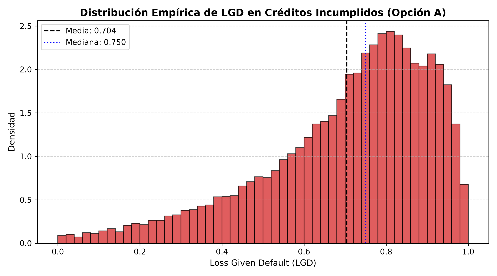
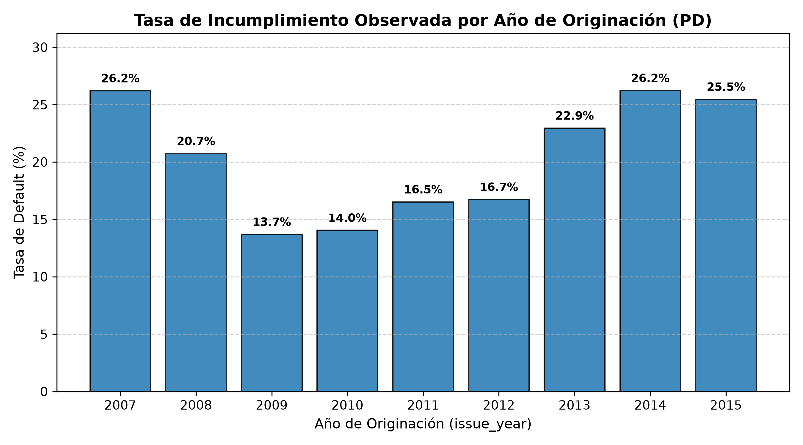
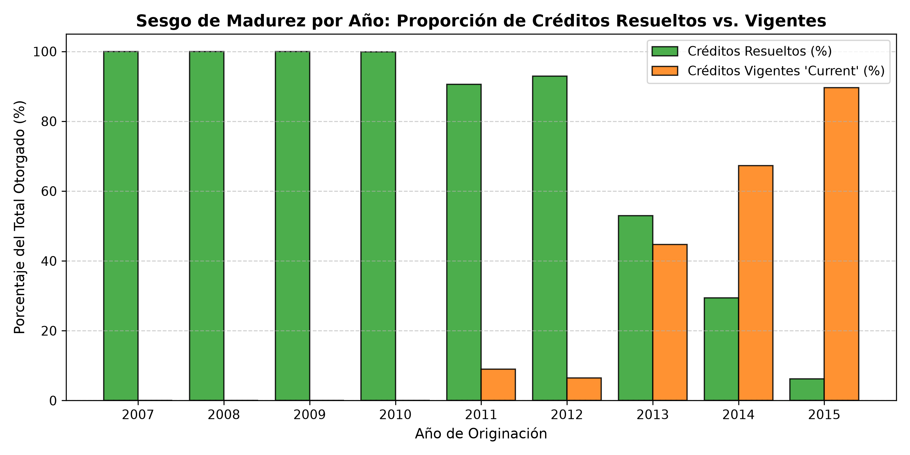
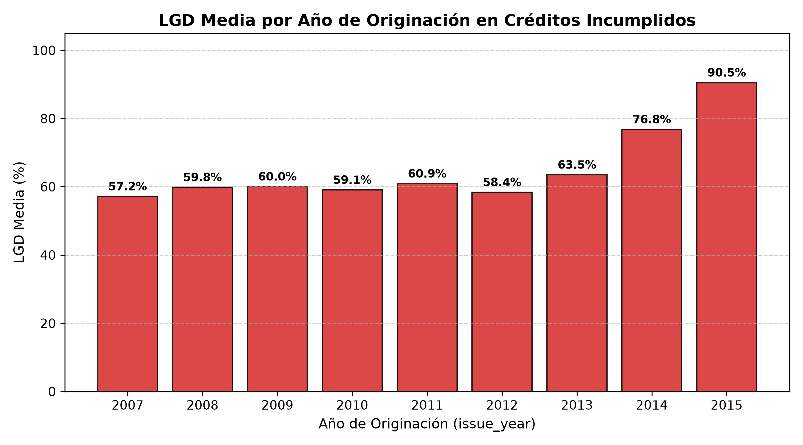
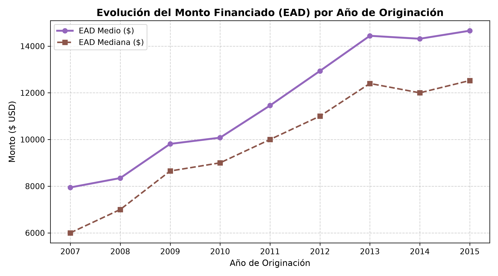

# Sección 3.1: Definición Formal de Variables Objetivo y Dinámica Temporal

**Curso:** Redes Neuronales y Algoritmos Bioinspirados  
**Universidad:** Universidad Nacional de Colombia  
**Proyecto:** Trabajo 2 — Redes neuronales para datos tabulares (*¿me prestas?*)  

---

## 1. Probabilidad de Incumplimiento (PD): Problema de Clasificación Binaria

La probabilidad de incumplimiento ($PD$) modela la verosimilitud de que un cliente caiga en cesación definitiva de pagos durante el ciclo de vida del crédito.

### A. Codificación Formal del Objetivo Binario $y \in \{0, 1\}$
A partir de la variable categórica `loan_status`, se construyó la etiqueta binaria $\text{target\_pd}$:

$$y_i = \begin{cases} 
0, & \text{si } \text{loan\_status}_i \in \{\text{'Fully Paid'}, \text{'Does not meet the credit policy. Status:Fully Paid'}\} \\
1, & \text{si } \text{loan\_status}_i \in \{\text{'Charged Off'}, \text{'Default'}, \text{'Late (31-120 days)'}, \text{'Does not meet the credit policy. Status:Charged Off'}\} \\
\text{NA}, & \text{si } \text{loan\_status}_i \in \{\text{'Current'}, \text{'Issued'}, \text{'In Grace Period'}, \text{'Late (16-30 days)'}\}
\end{cases}$$

### B. Justificación de Estados y Exclusión de Indeterminados
Siguiendo los lineamientos de la guía y la normativa de Basilea:
- Los créditos con desenlace incierto (`Current`, `Issued`, `In Grace Period`, `Late (16-30 days)`) suman **618,849 registros (69.74% del dataset original)** y se excluyen del entrenamiento y evaluación porque asignarles arbitrariamente 0 o 1 falsearía la probabilidad empírica.
- Quedan **268,530 créditos resueltos**, con una **tasa global de default del 21.90%** (209,711 buenos pagadores vs. 58,819 incumplidos).

### C. Tasas Observadas por Partición
| Partición | Esquema | Registros Totales | Tasa de Default ($PD$ Media) |
| :--- | :--- | :---: | :---: |
| **Train** | Temporal (2007–2013) | 163,541 | **19.28 %** |
| **Validation** | Temporal (2014) | 74,154 | **26.22 %** |
| **Test** | Temporal (2015) | 30,835 | **25.46 %** |
| **Train** | Aleatorio (70%) | 187,971 | **21.90 %** |
| **Validation** | Aleatorio (15%) | 40,279 | **21.90 %** |
| **Test** | Aleatorio (15%) | 40,280 | **21.90 %** |

---

## 2. Pérdida Dado el Incumplimiento (LGD): Problema de Regresión Acotada

Para el universo de créditos que fallaron ($y_i = 1$, con $N = 58,819$ créditos), el banco recupera una parte del capital a través de cobranza extrajudicial o remate de cartera. La severidad o fracción no recuperada corresponde a la $LGD \in [0, 1]$.

### A. Formulación Matemática Adoptada (Opción A: Coherente con Admisión)
Se adoptó la **Opción A**, donde tanto $LGD$ como la exposición $EAD$ comparten la misma base contractual: el monto financiado al desembolso:

$$\text{EAD}_i = \text{funded\_amnt}_i$$

$$\text{pérdida}_i = \text{funded\_amnt}_i - \text{total\_rec\_prncp}_i - (\text{recoveries}_i - \text{collection\_recovery\_fee}_i)$$

$$\text{LGD}_i = \max\left(0, \min\left(1, \frac{\text{pérdida}_i}{\text{funded\_amnt}_i}\right)\right)$$

### B. Justificación Económica de cada Término
1. `funded_amnt`: Capital total desembolsado por el prestamista al inicio.
2. `total_rec_prncp`: Amortización de principal pagada normalmente por el cliente antes de incurrir en mora definitiva.
3. `recoveries`: Flujo bruto de recuperaciones obtenido con posterioridad al castigo contable del crédito (*charge-off*).
4. `collection_recovery_fee`: Comisión pagada a agencias externas de cobranza. Se resta de `recoveries` porque representa una merma del monto bruto recuperado (recuperación neta).

### C. Parámetros Descriptivos y Distribución Empírica de LGD
- **LGD Media:** $0.7042$ ($70.42\%$).
- **LGD Mediana:** $0.7501$ ($75.01\%$).
- **Desviación Estándar:** $0.2048$.
- **LGD = 0.0 (Recuperación total del saldo):** $0.08\%$ de las observaciones.
- **LGD = 1.0 (Pérdida absoluta sin cobranza exitosa):** $0.61\%$ de las observaciones.

### D. Limitaciones Teóricas y Empíricas de la Formulación
1. **Ausencia de valor del dinero en el tiempo:** La fórmula contable no descuenta los flujos de recuperación a una tasa de interés efectiva intertemporal.
2. **Censura en créditos recientes:** La recuperación toma en promedio entre 24 y 48 meses; los créditos en default de 2014 y 2015 apenas iniciaban el proceso de cobro al corte de la base de datos.
3. **Restricción de dominio $[0, 1]$:** Se requiere una función de activación final sigmoide o Beta en la red neuronal para respetar los límites teóricos del intervalo unitario.

---

## 3. Dinámica Temporal y Sesgo de Madurez (*Maturity Bias*)

### A. Tasa de Default Anual
La tasa observada de mora varía marcadamente a lo largo de los años de originación:

### B. Demostración Empírica del Sesgo de Madurez
Al analizar el dataset crudo completo frente al subconjunto de créditos resueltos, se evidencia la presencia masiva de créditos no madurados:

- En **2011**, más del $90\%$ de los créditos completaron su ciclo.
- En **2014**, el $67.29\%$ de los préstamos seguían vigentes (`Current`).
- En **2015**, el **$89.66\%$** ($377,553$ créditos) se encontraban vigentes al momento de la extracción.

> **Impacto en el modelado:** Los únicos créditos resueltos observables de la cohorte 2015 son aquellos que entraron en default acelerado en sus primeros meses de vida. Los buenos pagadores a 36 y 60 meses aún no habían concluido sus amortizaciones. Este fenómeno de **censura por derecha** explica por qué la partición temporal de Test 2015 presenta una tasa de default aparentemente más alta ($25.46\%$) y una LGD empírica severamente más elevada ($90.5\%$, visible en la Figura de LGD anual), aspecto clave a defender en la sustentación oral.

