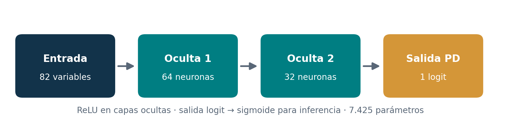

# 3.2 Neurona artificial, perceptrón multicapa y funciones de activación

**Curso:** Redes Neuronales y Algoritmos Bioinspirados  
**Universidad:** Universidad Nacional de Colombia  
**Proyecto:** Trabajo 2 — Redes neuronales para datos tabulares (*¿me prestas?*)  
**Estado:** borrador para integración

> Esta sección formaliza la neurona artificial, la propagación hacia adelante de un perceptrón multicapa (MLP) y las funciones de activación disponibles en el núcleo implementado por P2. Se ilustra con la arquitectura PD escogida a partir de la búsqueda de hiperparámetros. La derivación probabilística de las pérdidas está en la sección 3.3; la retropropagación, en la 3.4; y las ecuaciones de Adam y la regularización, en la 3.5. La numeración de figuras y tablas es provisional hasta la integración del informe.

---

## 1. La neurona artificial como función parametrizada

Una **neurona artificial** calcula una combinación afín de sus entradas y aplica una función de activación. Para un vector de características $\mathbf{x}=(x_1,\ldots,x_d)^\mathsf{T}\in\mathbb{R}^{d}$:

$$
z=\sum_{j=1}^{d}w_jx_j+b=\mathbf{w}^\mathsf{T}\mathbf{x}+b,
\qquad a=\phi(z).
$$

Aquí $w_j$ es el peso de la característica $x_j$, $b$ es el **sesgo**, $z$ es la entrada neta o *preactivación*, $\phi$ es la función de activación y $a$ es la salida de la neurona. El aprendizaje modifica los parámetros $\mathbf{w}$ y $b$ para reducir una función de pérdida.

Por ejemplo, si $\mathbf{x}=(0{,}5,1)$, $\mathbf{w}=(0{,}8,-0{,}3)$ y $b=0{,}1$, entonces $z=0{,}8(0{,}5)-0{,}3(1)+0{,}1=0{,}2$. Con activación ReLU, la neurona entrega $a=\max(0,0{,}2)=0{,}2$. Este ejemplo ilustra el cálculo; los valores **no** corresponden a pesos aprendidos por el modelo real.

La transformación afín es diferenciable respecto a sus parámetros:

$$
\frac{\partial z}{\partial w_j}=x_j,
\qquad \frac{\partial z}{\partial b}=1,
\qquad \frac{\partial z}{\partial x_j}=w_j.
$$

Estas identidades permiten calcular los gradientes durante la retropropagación (sección 3.4).

## 2. Del perceptrón a un MLP

Un perceptrón multicapa (*multilayer perceptron*, **MLP**) conecta varias capas de neuronas. La primera recibe las variables de entrada, las intermedias calculan representaciones ocultas y la última entrega la predicción. Para la capa $\ell$:

$$
\mathbf{a}^{(0)}=\mathbf{x},\qquad
\mathbf{z}^{(\ell)}=W^{(\ell)}\mathbf{a}^{(\ell-1)}+\mathbf{b}^{(\ell)},\qquad
\mathbf{a}^{(\ell)}=\phi_{\ell}\!\left(\mathbf{z}^{(\ell)}\right).
$$

Si la capa anterior tiene $n_{\ell-1}$ unidades y la actual tiene $n_{\ell}$, entonces $W^{(\ell)}\in\mathbb{R}^{n_{\ell}\times n_{\ell-1}}$ y $\mathbf{b}^{(\ell)}\in\mathbb{R}^{n_{\ell}}$. Las activaciones se aplican elemento a elemento.

**Por qué son necesarias las no linealidades.** Si todas las capas usaran $\phi(z)=z$, dos capas sucesivas producirían

$$
W^{(2)}(W^{(1)}\mathbf{x}+\mathbf{b}^{(1)})+\mathbf{b}^{(2)}
=\underbrace{W^{(2)}W^{(1)}}_{\widetilde W}\mathbf{x}
+\underbrace{W^{(2)}\mathbf{b}^{(1)}+\mathbf{b}^{(2)}}_{\widetilde{\mathbf b}}.
$$

Es decir, cualquier cadena exclusivamente afín equivale a **una sola transformación afín**. Al introducir ReLU, tanh o sigmoide en capas ocultas, el MLP puede representar relaciones no lineales que una regresión lineal no expresa de ese modo.

En el repositorio, `src/models/mlp.py` contiene el MLP configurable y `build_mlp` construye la red a partir del número y tamaño de capas, la activación y el dropout. Ese diseño es reutilizable por las tareas PD y LGD, aunque sus salidas y objetivos estadísticos son diferentes.

## 3. Arquitectura del clasificador PD del proyecto

El preprocesamiento de P1 entrega **82 características transformadas por observación**. No se deben confundir con el número de campos originales del formulario de la aplicación: el vector de entrada del modelo contiene características ya codificadas y transformadas. Para la configuración PD seleccionada, la arquitectura es **82–64–32–1**:

*Figura 3.2.1.* Arquitectura seleccionada para PD. ReLU en las dos capas ocultas; un logit en la salida y sigmoide únicamente para convertirlo en probabilidad. *Fuente:* elaboración propia a partir de `configs/pd_mlp.yaml` y `src/models/mlp.py`.

La propagación hacia adelante queda dada por:

$$
\begin{aligned}
\mathbf{h}_1 &= \operatorname{ReLU}(W^{(1)}\mathbf{x}+\mathbf{b}^{(1)}), &&\mathbf{h}_1\in\mathbb{R}^{64},\\
\mathbf{h}_2 &= \operatorname{ReLU}(W^{(2)}\mathbf{h}_1+\mathbf{b}^{(2)}), &&\mathbf{h}_2\in\mathbb{R}^{32},\\
z &= W^{(3)}\mathbf{h}_2+b^{(3)}, &&z\in\mathbb{R},\\
\widehat p &= \sigma(z)=\frac{1}{1+e^{-z}}, &&0<\widehat p<1.
\end{aligned}
$$

En PD, $\widehat p$ representa la probabilidad estimada de incumplimiento. Durante el entrenamiento se usa el **logit $z$ directamente** en `BCEWithLogitsLoss`; no debe aplicarse sigmoide antes de esa pérdida, pues la función ya incorpora la transformación de manera numéricamente estable. Para inferencia, `predict_pd` sí convierte el logit en probabilidad.

### 3.1 Conteo exacto de parámetros

Cada capa totalmente conectada tiene $n_{\mathrm{salida}}n_{\mathrm{entrada}}$ pesos y $n_{\mathrm{salida}}$ sesgos. Por tanto:

| Capa | Matriz de pesos | Pesos | Sesgos | Total |
|:--|:--|--:|--:|--:|
| Entrada $\to$ oculta 1 | $64\times82$ | 5.248 | 64 | 5.312 |
| Oculta 1 $\to$ oculta 2 | $32\times64$ | 2.048 | 32 | 2.080 |
| Oculta 2 $\to$ salida | $1\times32$ | 32 | 1 | 33 |
| **Total** | — | **7.328** | **97** | **7.425** |

*Tabla 3.2.1.* Parámetros entrenables de la arquitectura PD. *Fuente:* cálculo propio a partir de las dimensiones de las capas, verificable con `sum(p.numel() for p in model.parameters() if p.requires_grad)`.

El número de parámetros no equivale al número de observaciones. En este caso, las particiones temporales de PD contienen **163.541 ejemplos de entrenamiento**, **74.154 de validación** y **30.835 de prueba**; su construcción y la prevención de fuga de información son responsabilidad de la sección de datos.

## 4. Funciones de activación utilizadas o disponibles

El núcleo desarrollado permite usar **ReLU, tangente hiperbólica (tanh) y sigmoide**. Su papel depende de la capa y de la tarea. La activación seleccionada en las capas ocultas del clasificador PD final es **ReLU**. La sigmoide se utiliza para interpretar el logit PD como probabilidad; para LGD se contempla una salida acotada, cuya elección se documenta en las secciones 3.3 y 6.

### 4.1 ReLU: unidad lineal rectificada

$$
\operatorname{ReLU}(z)=\max(0,z)=
\begin{cases}0,&z\leq0,\\z,&z>0.\end{cases}
$$

Su derivada clásica existe salvo en $z=0$:

$$
\operatorname{ReLU}'(z)=
\begin{cases}0,&z<0,\\1,&z>0.\end{cases}
$$

En el punto $z=0$, PyTorch utiliza por convención el valor de gradiente **0**. Para $z>0$, la derivada es constante y no introduce por sí misma un factor pequeño en el gradiente. Para $z<0$, el gradiente local es cero; esa es la contrapartida de su simplicidad computacional.

### 4.2 Sigmoide logística

$$
\sigma(z)=\frac{1}{1+e^{-z}}.
$$

Derivando con la regla de la cadena:

$$
\sigma'(z)=\frac{e^{-z}}{(1+e^{-z})^2}
=\frac{1}{1+e^{-z}}\left(1-\frac{1}{1+e^{-z}}\right)
=\boxed{\sigma(z)\bigl(1-\sigma(z)\bigr)}.
$$

Su rango es $(0,1)$, apropiado para expresar probabilidades. Sin embargo, $\sigma'(z)$ tiende a cero cuando $z\to\pm\infty$, motivo por el que puede haber **saturación** si se usa repetidamente en capas ocultas. En la salida PD, `BCEWithLogitsLoss` combina la sigmoide con la pérdida de forma estable y simplifica el gradiente respecto al logit (sección 3.4).

### 4.3 Tangente hiperbólica

$$
\tanh(z)=\frac{e^z-e^{-z}}{e^z+e^{-z}}=\frac{\sinh(z)}{\cosh(z)}.
$$

Aplicando la regla del cociente y la identidad $\cosh^2(z)-\sinh^2(z)=1$:

$$
\frac{d\tanh(z)}{dz}
=\frac{\cosh^2(z)-\sinh^2(z)}{\cosh^2(z)}
=\boxed{1-\tanh^2(z)}.
$$

Su salida se sitúa en $(-1,1)$ y está centrada alrededor de cero, a diferencia de la sigmoide. También presenta saturación en los extremos.

### 4.4 Comparación resumida

| Activación | Expresión | Derivada local | Uso en este trabajo |
|:--|:--|:--|:--|
| ReLU | $\max(0,z)$ | $0$ o $1$ (salvo $z=0$) | Capas ocultas del MLP PD seleccionado |
| Sigmoide | $1/(1+e^{-z})$ | $\sigma(z)(1-\sigma(z))$ | Convertir el logit PD en probabilidad; salida acotada cuando corresponde |
| Tanh | $\tanh(z)$ | $1-\tanh^2(z)$ | Alternativa configurable en las capas ocultas, examinada en ablaciones |
| Identidad | $z$ | $1$ | Salida **logit** del MLP PD antes de `BCEWithLogitsLoss` |

*Tabla 3.2.2.* Funciones de activación y su papel. *Fuente:* elaboración propia; fórmulas y derivadas analíticas.

## 5. Relación con la implementación y los experimentos

La arquitectura del MLP se define en `src/models/mlp.py`; el entrenador específico de clasificación está en `src/models/pd_mlp.py`. El archivo `configs/pd_mlp.yaml` registra la configuración seleccionada: dos capas ocultas de **64 y 32 neuronas**, activación **ReLU**, `dropout: 0.0`, tasa de aprendizaje **0.003**, tamaño de lote **512** y regularización configurada como `l2: 0.0001`. El entrenamiento utiliza una salida escalar por observación y la pérdida BCE con logits. La comparación experimental entre alternativas de arquitectura pertenece al capítulo 5.

La opción `dropout: 0.0` significa que **no se aplica dropout en esta configuración final**, aunque el núcleo admite ese mecanismo en otras configuraciones. La formulación de dropout, L1, L2 y parada temprana está desarrollada en la sección 3.5, no aquí.

| Concepto | Evidencia en el repositorio |
|:--|:--|
| Capas lineales, activaciones y método de propagación | `src/models/mlp.py` |
| Construcción de la arquitectura configurable | `build_mlp` en `src/models/mlp.py` |
| Entrenamiento PD y obtención de probabilidades | `train_pd_mlp`, `predict_pd` en `src/models/pd_mlp.py` |
| Configuración usada para la selección de PD | `configs/pd_mlp.yaml` |
| Programa de entrenamiento reproducible | `src/experiments/train_pd.py` |

*Tabla 3.2.3.* Trazabilidad de las definiciones matemáticas al código. *Fuente:* organización del repositorio del proyecto.

## 6. Referencias

- Goodfellow, I., Bengio, Y. y Courville, A. (2016). *Deep Learning*. MIT Press, capítulo 6. https://www.deeplearningbook.org/
- Nair, V. y Hinton, G. E. (2010). Rectified Linear Units Improve Restricted Boltzmann Machines. *Proceedings of ICML 2010*, 807–814.
- PyTorch. (s. f.). *BCEWithLogitsLoss* y módulos de activación de `torch.nn`. https://docs.pytorch.org/docs/stable/nn.html

*Nota de integración:* este apartado desarrolla la fundamentación de P2 sin reemplazar las secciones 3.3, 3.4 o 3.5. Las referencias cruzadas y la numeración definitiva deberán unificarse al ensamblar el informe técnico.
