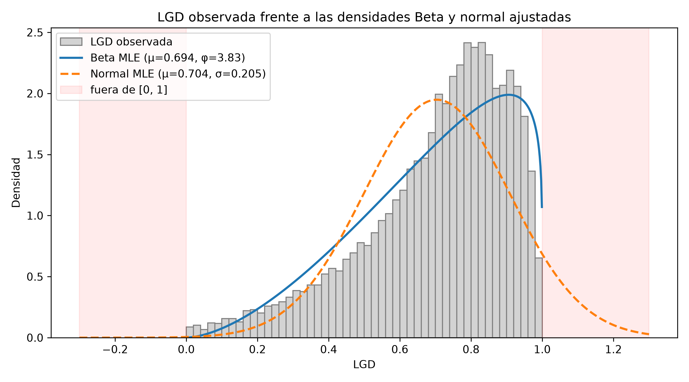
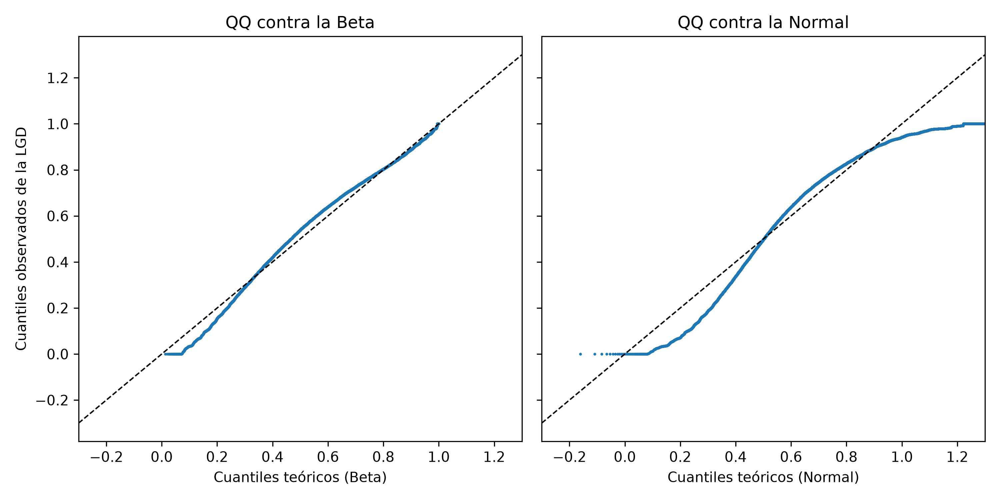
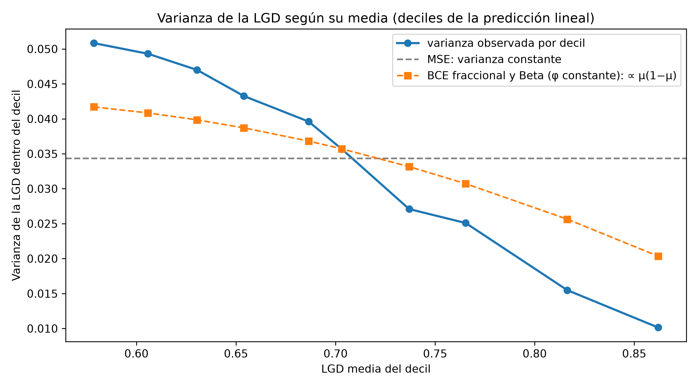

# Sección 3.3 (borrador): función de pérdida y activación de salida para la red de LGD

**Curso:** Redes Neuronales y Algoritmos Bioinspirados  
**Universidad:** Universidad Nacional de Colombia  
**Proyecto:** Trabajo 2 — Redes neuronales para datos tabulares (*¿me prestas?*)  
**Responsable:** P3 · **Revisión:** P2 · **Estado:** borrador de la Fase 2, escrito antes de entrenar la red

> Este documento fija las funciones de pérdida candidatas, la activación de salida y el criterio de
> selección **antes** de la búsqueda de hiperparámetros, para que la elección no se justifique a
> posteriori con el resultado que salió mejor por azar. Los resultados se reportarán en la sección 6.
> La numeración de figuras es provisional (3.3.x) hasta la integración del blog.

---

## 1. La variable objetivo y su distribución

La LGD se construyó con la opción A (sección 3.1): para los créditos incumplidos,
$\text{LGD} = \text{clip}\big((\text{funded\_amnt} - \text{total\_rec\_prncp} - \text{recoveries} + \text{collection\_recovery\_fee}) / \text{funded\_amnt},\ 0,\ 1\big)$.
Todo el análisis de esta sección usa la partición aleatoria de entrenamiento ($n = 41.173$).

**Forma.** Media 0,704, desviación estándar 0,205 y **asimetría −0,99**: una cola larga hacia 0 y la
masa concentrada entre 0,6 y 0,95. Solo el 0,66 % de los valores son exactamente 0 o 1 (35 y 235
créditos). Como se observa en la Figura 3.3.1, la distribución es unimodal, sin las masas en los
extremos que a veces se describen para la LGD.

**Figura 3.3.1.** LGD observada frente a las densidades Beta y normal ajustadas por máxima
verosimilitud. Las bandas rojas marcan valores imposibles (fuera de [0, 1]).
*Fuente:* elaboración propia con datos de Lending Club (Kaggle), partición aleatoria de
entrenamiento de LGD; código en `src/models/lgd_mlp.py` (`figuras_distribucion_lgd`).

**Ajuste de dos distribuciones candidatas.** Se ajustaron por máxima verosimilitud una normal y una
Beta con media y precisión constantes. La Beta se ajustó con la misma pérdida que usará la red
(`beta_con_logits`) y dio $\mu = 0{,}694$ y $\phi = 3{,}83$:

| Cuantil | LGD observada | Beta ajustada | Normal ajustada |
|---|---|---|---|
| 1 % | 0,100 | 0,161 | 0,227 |
| 5 % | 0,285 | 0,296 | 0,367 |
| 25 % | 0,594 | 0,553 | 0,566 |
| 50 % | 0,750 | 0,730 | 0,704 |
| 75 % | 0,858 | 0,867 | 0,842 |
| 95 % | 0,956 | 0,969 | 1,041 |
| 99 % | 0,987 | 0,992 | 1,180 |

*Tabla 3.3.1. Cuantiles de la LGD observada y de las distribuciones ajustadas. Fuente: elaboración
propia, misma partición que la Figura 3.3.1.*

- La normal asigna un **7,4 % de su masa fuera de [0, 1]**; su percentil 99 es 1,18, una LGD imposible.
- La log-verosimilitud media es 0,283 con la Beta y 0,167 con la normal.
- La Beta no es perfecta: sitúa la moda en 0,91 cuando el pico observado está cerca de 0,8, y
  sobrestima la cola baja (percentil 1: 0,161 frente a 0,100).

La Figura 3.3.2 lo muestra en forma de gráfico QQ: los cuantiles observados siguen la diagonal frente
a la Beta, salvo en la cola baja, mientras que frente a la normal describen una S y se salen del
intervalo [0, 1].

**Figura 3.3.2.** Gráficos QQ de la LGD observada contra la Beta (izquierda) y la normal (derecha)
ajustadas. *Fuente:* elaboración propia, misma partición y código que la Figura 3.3.1.

**La varianza depende de la media.** Para ver cómo cambia la dispersión con el nivel de la LGD, se
agruparon los créditos en deciles de la predicción de la regresión lineal de referencia y se calculó
la varianza de la LGD dentro de cada decil (Figura 3.3.3). La varianza **cae de 0,052 a 0,009** (casi
seis veces) cuando la LGD media pasa de 0,57 a 0,86.

**Figura 3.3.3.** Varianza de la LGD dentro de cada decil de la predicción lineal, frente a la forma
que supone cada función de pérdida (cada supuesto se escala a la varianza promedio observada, de modo
que solo se compara la forma). *Fuente:* elaboración propia, misma partición y código que la
Figura 3.3.1.

**Las variables explican una parte pequeña de la LGD.** La regresión lineal de referencia (P2) obtiene
$R^2 = 0{,}18$ en validación, y sus predicciones tienen una desviación estándar de 0,089 frente a 0,204
de la LGD observada.

---

## 2. Activación de salida: sigmoide

La LGD pertenece a [0, 1], así que la salida de la red debe estar en ese intervalo. Se usa la
sigmoide, $\mu = \sigma(z) = 1/(1+e^{-z})$, aplicada al logit $z$ que produce la última capa lineal.
La red entrega $z$ y la sigmoide se aplica dentro de la función de pérdida y al predecir. Es
matemáticamente la misma salida sigmoide, pero permite calcular las pérdidas que contienen logaritmos
de forma numéricamente estable. Las tres candidatas comparten esta salida, de modo que la única
diferencia entre ellas es el modelo probabilístico del error.

---

## 3. Funciones de pérdida candidatas

Las tres se derivan por máxima verosimilitud (o cuasi-verosimilitud) y están implementadas y
verificadas contra diferenciación automática en `src/models/losses.py`.

### 3.1 MSE (modelo normal)

- **Modelo:** $Y \mid x \sim \mathcal{N}(\sigma(z), s^2)$ con varianza $s^2$ constante. La NLL, sin
  constantes, es proporcional a $\frac1n\sum_i (y_i - \sigma(z_i))^2$.
- **A favor:** su minimizador es la media condicional $E[Y \mid x]$ sea cual sea la distribución real,
  y optimiza directamente el RMSE.
- **En contra, contrastado con los datos:**
  - Supone varianza constante; la Figura 3.3.3 muestra que la varianza cae casi seis veces.
  - El modelo normal pone probabilidad fuera de [0, 1] (Tabla 3.3.1).
  - Con salida sigmoide el gradiente se anula cuando la red está muy segura y equivocada (factor
    $\sigma(z)(1-\sigma(z))$ en la regla de la cadena).

### 3.2 BCE fraccional (cuasi-verosimilitud de Bernoulli)

- **Modelo:** solo se supone la media, $E[Y \mid x] = \sigma(z)$. La pérdida
  $-[\,y\ln\mu + (1-y)\ln(1-\mu)\,]$ con $y$ continua **no es una verosimilitud** (no integra a 1 en
  [0, 1]); es una cuasi-verosimilitud que equivale a suponer $\text{Var}(Y \mid x) \propto \mu(1-\mu)$.
- **A favor:** su minimizador también es $E[Y \mid x]$ para cualquier distribución; acepta valores 0 y 1
  sin tratamiento especial; su gradiente, $\sigma(z) - y$, no se satura; y pondera los errores de forma
  coherente con una variable acotada.
- **En contra:** la forma $\mu(1-\mu)$ capta solo parte de la caída de la varianza (Figura 3.3.3);
  no produce una distribución predictiva completa; su valor tiene un piso igual a la entropía de $y$
  y no es comparable con el de las otras pérdidas.

### 3.3 Beta (regresión Beta)

- **Modelo:** $Y \mid x \sim \text{Beta}(\mu\phi, (1-\mu)\phi)$ con $\mu = \sigma(z)$ y una precisión
  $\phi$ común aprendida. $E[Y] = \mu$ y $\text{Var}(Y) = \mu(1-\mu)/(1+\phi)$.
- **A favor:** es una verosimilitud verdadera en (0, 1); describe la distribución marginal mucho mejor
  que la normal (Tabla 3.3.1, Figuras 3.3.1 y 3.3.2); es la única de las tres que da una distribución
  predictiva completa; su gradiente no se satura.
- **En contra:**
  - No admite 0 ni 1 exactos: se recortan a $[\varepsilon, 1-\varepsilon]$ con $\varepsilon = 10^{-4}$
    (0,66 % de los datos). Esos puntos entran en la verosimilitud con $\ln\varepsilon$, mucho más que un
    dato típico ($\ln 0{,}75 = -0{,}29$); en el ajuste sin variables mueven sobre todo $\phi$ (de 4,13
    con $\varepsilon = 10^{-2}$ a 3,72 con $\varepsilon = 1{,}2\times10^{-5}$) y casi nada la media
    ajustada (0,6941 a 0,6943).
  - Con $\phi$ constante supone la misma forma de varianza que la BCE fraccional, que se queda corta
    frente a la caída observada (Figura 3.3.3).
  - **No iguala la media muestral.** Los estadísticos suficientes de la Beta son $\ln y$ y
    $\ln(1-y)$, no $y$: la máxima verosimilitud elige $(\mu, \phi)$ de modo que
    $\psi(\alpha)-\psi(\alpha+\beta) = \overline{\ln y}$ y $\psi(\beta)-\psi(\alpha+\beta) =
    \overline{\ln(1-y)}$, es decir, iguala los log-momentos esperados con los muestrales. Solo si los
    datos siguen una Beta eso equivale a estimar bien la media. Con datos simulados de una Beta, la media
    ajustada coincide con la muestral (diferencia +0,0002); con la LGD observada, sin variables, queda
    0,0096 por debajo (0,6941 frente a 0,7038), con cualquier $\varepsilon$ y también excluyendo los 0 y
    1 exactos, así que la diferencia se debe a la forma de la distribución y no al recorte.

---

## 4. Criterio de selección (fijado antes de entrenar)

1. **Métrica principal:** RMSE en la **validación aleatoria**. Las tres pérdidas se comparan por la
   métrica de evaluación y no por sus propios valores, que están en escalas distintas.
2. **Partición:** aleatoria. En la temporal, la LGD media es 0,615 en entrenamiento, 0,768 en
   validación y 0,905 en prueba, por la censura de las recuperaciones de los créditos recientes
   (sección 3.1); seleccionar con ella castigaría a cualquier modelo por un artefacto de los datos. La
   partición temporal se reportará como análisis de estabilidad.
3. **Desempate:** comparación de la distribución de las predicciones con la distribución observada,
   como pide el enunciado (histograma y cuantiles de las predicciones puntuales de cada modelo).
4. **Presupuesto:** las tres pérdidas entran como un hiperparámetro más en la misma búsqueda, con el
   mismo presupuesto, que se declarará en la sección 4.
5. **Conjunto de prueba:** no se usa para seleccionar; se evalúa una sola vez al final.

---

## 5. Predicciones escritas antes de entrenar

Se contrastarán con los resultados en la sección 6.

1. **RMSE parecido entre las tres pérdidas.** Las tres estiman (o aproximan) la media condicional, y
   el $R^2$ de 0,18 de la lineal sugiere que el techo lo pone la información de las variables más que
   la pérdida.
2. **Las predicciones de las tres estarán encogidas** respecto de la LGD observada (desviación estándar
   muy por debajo de 0,204, como ya ocurre con la lineal). Es una propiedad de predecir medias
   condicionales, no un defecto de una pérdida en particular.
3. **La MSE no debería superar a la BCE fraccional**, porque supone varianza constante cuando la
   varianza real cambia con la media; la diferencia, si la hay, debería verse en los créditos de LGD
   alta.
4. **La Beta será la que mejor describa la forma de la distribución**, pero no necesariamente la de
   menor RMSE.

---

## 6. Limitaciones y ajustes posibles

- **Precisión no constante.** La varianza observada cae más rápido que $\mu(1-\mu)$ (Figura 3.3.3), lo
  que sugiere que $\phi$ podría depender de las variables. Modelarlo exigiría una segunda salida en la
  red; queda como posible ajuste si la distribución predicha no reproduce la observada.
- **Sensibilidad a $\varepsilon$** en la Beta: se evaluará con
  $\varepsilon \in \{10^{-2}, 10^{-3}, 10^{-4}, 1{,}2\times10^{-5}\}$ (el último equivale a la
  transformación de Smithson y Verkuilen con el $n$ de entrenamiento).
- **Análisis marginal.** La Tabla 3.3.1 y las Figuras 3.3.1 y 3.3.2 describen la distribución de la LGD
  sin condicionar a las variables; la red ajusta una distribución por crédito, así que la evidencia
  decisiva será la comparación de la sección 6.
- **Censura temporal** de las recuperaciones (sección 3.1).

---

## Referencias por verificar

Antes de citarlas en la versión final deben confirmarse autores, año, título y DOI en la fuente
primaria:

- Ferrari y Cribari-Neto (2004), sobre regresión Beta con parametrización media–precisión.
- Papke y Wooldridge (1996), sobre modelos para respuestas fraccionales.
- Smithson y Verkuilen (2006), sobre la transformación de valores 0 y 1 en regresión Beta.
