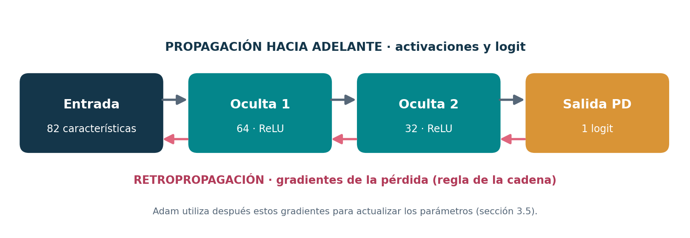

# 3.4 Retropropagación: derivación de gradientes del MLP

**Curso:** Redes Neuronales y Algoritmos Bioinspirados  
**Universidad:** Universidad Nacional de Colombia  
**Proyecto:** Trabajo 2 — Redes neuronales para datos tabulares (*¿me prestas?*)  
**Estado:** borrador para integración

> La sección 3.2 define la neurona, el MLP y las derivadas de sus activaciones. La sección 3.3 deduce las pérdidas mediante modelos probabilísticos. Aquí se demuestra **cómo** aplicar la regla de la cadena para obtener gradientes en todos los pesos y sesgos, utilizando la clasificación PD como ejemplo. Las ecuaciones de **actualización de Adam** y las técnicas de regularización pertenecen a la sección 3.5. Las pruebas reproducibles se incluyen al final de este apartado.

---

## 1. Qué calcula la retropropagación

En la propagación **hacia adelante**, la red transforma cada vector de características $\mathbf{x}$ en una predicción. Durante la **retropropagación** (*backpropagation*) se recorren las capas en sentido inverso para calcular las derivadas de la pérdida $L$ respecto a los parámetros $\theta=\{W^{(\ell)},\mathbf b^{(\ell)}\}_{\ell=1}^{K}$:

$$
\nabla_{\theta}L
=\left\{\frac{\partial L}{\partial W^{(\ell)}},
\frac{\partial L}{\partial\mathbf b^{(\ell)}}\right\}_{\ell=1}^{K}.
$$

Conviene distinguir **tres operaciones**:

1. **Propagación hacia adelante:** calcular las activaciones y el logit.
2. **Retropropagación:** calcular las derivadas de la pérdida mediante la regla de la cadena.
3. **Optimización:** utilizar esas derivadas para actualizar los parámetros. El algoritmo Adam y su corrección de sesgo se derivan en la sección 3.5.

En el MLP PD seleccionado las dimensiones son $82\to64\to32\to1$, por lo que hay tres matrices de pesos. La ecuación general de la sección 3.2 es:

$$
\mathbf z^{(\ell)}=W^{(\ell)}\mathbf a^{(\ell-1)}+\mathbf b^{(\ell)},
\qquad \mathbf a^{(0)}=\mathbf x.
$$

Las capas ocultas usan ReLU. La última produce el logit $z=z^{(3)}$ y, solo para interpretar la predicción como probabilidad, $\hat p=\sigma(z)$.



*Figura 3.4.1.* El cálculo de activaciones avanza desde las variables hasta el logit; el gradiente de la pérdida regresa desde la salida hasta los parámetros de las primeras capas. *Fuente:* elaboración propia.

## 2. Gradiente de salida para la pérdida BCE

El resultado probabilístico se fundamenta en la sección 3.3. Para $y\in\{0,1\}$, $\hat p=\sigma(z)$ y una observación:

$$
\ell(y,\hat p)=-\left[y\ln\hat p+(1-y)\ln(1-\hat p)\right].
$$

**Paso 1.** Derivar la pérdida con respecto a la probabilidad:

$$
\frac{\partial\ell}{\partial\hat p}
=-\frac{y}{\hat p}+\frac{1-y}{1-\hat p}.
$$

**Paso 2.** Derivar la sigmoide con respecto al logit (sección 3.2):

$$
\frac{\partial\hat p}{\partial z}=\hat p(1-\hat p).
$$

**Paso 3.** Aplicar la regla de la cadena y simplificar:

$$
\begin{aligned}
\frac{\partial\ell}{\partial z}
&=\frac{\partial\ell}{\partial\hat p}\frac{\partial\hat p}{\partial z}\\
&=\left[-\frac{y}{\hat p}+\frac{1-y}{1-\hat p}\right]\hat p(1-\hat p)\\
&=-y(1-\hat p)+(1-y)\hat p\\
&=\boxed{\hat p-y}.
\end{aligned}
$$

Esta simplificación es central: el gradiente respecto al logit es el **error probabilístico firmado**. Si $y=1$ y $\hat p=0{,}4$, el gradiente es $-0{,}6$; el descenso de la pérdida impulsa a aumentar el logit. Si $y=0$ y $\hat p=0{,}4$, el gradiente es $+0{,}4$; impulsa a disminuirlo.

También puede derivarse directamente desde la forma estable de la BCE:

$$
\ell(z,y)=\ln(1+e^z)-yz,
\qquad \frac{\partial\ell}{\partial z}=\sigma(z)-y.
$$

Esta es la expresión compatible con `BCEWithLogitsLoss`: la **sigmoide está integrada en la pérdida** y no debe duplicarse antes de calcularla.

## 3. Regla de la cadena entre capas

Definimos el **error de preactivación** de la capa $\ell$ por

$$
\boldsymbol\delta^{(\ell)}
=\frac{\partial\ell}{\partial\mathbf z^{(\ell)}}.
$$

Para la capa de salida binaria del MLP PD:

$$
\boxed{\delta^{(3)}=\hat p-y}.
$$

En una capa oculta, la variación de la pérdida pasa primero por los pesos de la siguiente capa y después por la derivada de la activación actual. Por la regla de la cadena:

$$
\boxed{\boldsymbol\delta^{(\ell)}=
\left(W^{(\ell+1)\mathsf T}\boldsymbol\delta^{(\ell+1)}\right)
\odot\phi'_{\ell}\!\left(\mathbf z^{(\ell)}\right)}.
$$

El símbolo $\odot$ representa el producto **elemento a elemento**. Para la arquitectura con dos capas ocultas:

$$
\begin{aligned}
\boldsymbol\delta^{(2)}
&=\bigl(W^{(3)\mathsf T}\delta^{(3)}\bigr)\odot
\operatorname{ReLU}'(\mathbf z^{(2)}),\\
\boldsymbol\delta^{(1)}
&=\bigl(W^{(2)\mathsf T}\boldsymbol\delta^{(2)}\bigr)\odot
\operatorname{ReLU}'(\mathbf z^{(1)}).
\end{aligned}
$$

Las dimensiones permiten comprobar la consistencia: $\delta^{(3)}\in\mathbb R$, $\boldsymbol\delta^{(2)}\in\mathbb R^{32}$ y $\boldsymbol\delta^{(1)}\in\mathbb R^{64}$.

## 4. Gradientes de los pesos y de los sesgos

Para la neurona $j$ de la capa $\ell$, $z_j^{(\ell)}=\sum_k W_{jk}^{(\ell)}a_k^{(\ell-1)}+b_j^{(\ell)}$. Por tanto,

$$
\frac{\partial z_j^{(\ell)}}{\partial W_{jk}^{(\ell)}}
=a_k^{(\ell-1)},
\qquad
\frac{\partial z_j^{(\ell)}}{\partial b_j^{(\ell)}}=1.
$$

Aplicando de nuevo la regla de la cadena:

$$
\frac{\partial\ell}{\partial W_{jk}^{(\ell)}}
=\delta_j^{(\ell)}a_k^{(\ell-1)},
\qquad
\frac{\partial\ell}{\partial b_j^{(\ell)}}
=\delta_j^{(\ell)}.
$$

En forma matricial, para una observación:

$$
\boxed{\frac{\partial\ell}{\partial W^{(\ell)}}=
\boldsymbol\delta^{(\ell)}\mathbf a^{(\ell-1)\mathsf T}},
\qquad
\boxed{\frac{\partial\ell}{\partial\mathbf b^{(\ell)}}=
\boldsymbol\delta^{(\ell)}}.
$$

Por ejemplo, el gradiente de un peso $W_{jk}^{(1)}$ de la primera capa, después de expandir los dos pasos de propagación, tiene la forma:

$$
\frac{\partial\ell}{\partial W_{jk}^{(1)}}
=(\hat p-y)\,x_k\,\operatorname{ReLU}'(z_j^{(1)})
\sum_{r=1}^{32} W_{1r}^{(3)}\,
\operatorname{ReLU}'(z_r^{(2)})\,W_{rj}^{(2)}.
$$

Esta expresión muestra de dónde proviene cada factor: **error de salida**, **valor de la entrada**, **pesos de las conexiones posteriores** y **derivadas de las activaciones ocultas**.

### 4.1 Minibatches y reducción de la pérdida

En entrenamiento, la BCE se promedia sobre un lote de tamaño $N$:

$$
J(\theta)=\frac{1}{N}\sum_{i=1}^{N}\ell_i(\theta).
$$

En consecuencia, los gradientes correctos son los **promedios** de las contribuciones individuales:

$$
\frac{\partial J}{\partial W^{(\ell)}}
=\frac{1}{N}\sum_{i=1}^{N}\boldsymbol\delta_i^{(\ell)}\mathbf a_i^{(\ell-1)\mathsf T},
\qquad
\frac{\partial J}{\partial\mathbf b^{(\ell)}}
=\frac{1}{N}\sum_{i=1}^{N}\boldsymbol\delta_i^{(\ell)}.
$$

**Precisión de notación:** aquí cada $\boldsymbol\delta_i^{(\ell)}$ se define para la pérdida **individual**, sin el factor $1/N$. Si se empieza directamente por el gradiente de la pérdida promedio respecto a cada logit, ese factor ya aparece en $\delta$ y no debe aplicarse por segunda vez. La regularización agrega términos adicionales a los gradientes; su derivación corresponde a la sección 3.5.

## 5. De las ecuaciones al entrenamiento en PyTorch

El entrenamiento de PD implementado en `src/models/pd_mlp.py` utiliza diferenciación automática para calcular exactamente los gradientes anteriores sobre el grafo de operaciones. Su ciclo conceptual es:

```python
# Esquema conceptual del paso de entrenamiento; no es una transcripción literal.
logits = model(X_batch)
loss = criterion(logits, y_batch)  # BCEWithLogitsLoss
optimizer.zero_grad()            # evita acumular gradientes anteriores
loss.backward()                 # retropropagación: calcula p.grad
optimizer.step()                # Adam: actualiza los pesos y sesgos
```

`loss.backward()` y `optimizer.step()` **no son equivalentes**. El primero aplica la regla de la cadena y almacena gradientes; el segundo ejecuta la actualización según Adam. Los promedios móviles, la corrección de sesgo y la penalización de pesos se explican en la sección 3.5.

En validación, el cálculo se realiza sin actualizar parámetros. El entrenador compara la pérdida de validación entre épocas y utiliza *early stopping* con restauración de los mejores pesos; el procedimiento controla el sobreajuste, pero no cambia la derivación básica de las ecuaciones anteriores.

## 6. Comprobación de los gradientes frente a `autograd`

Una derivación analítica debe poder contrastarse con los gradientes obtenidos por diferenciación automática. El siguiente ejemplo **reproducible**, independiente de los datos crediticios, construye una red con dimensiones **82–64–32–1**, calcula manualmente los seis gradientes de sus matrices y sesgos y los compara con PyTorch en precisión doble.

```python
import torch
import torch.nn.functional as F

torch.manual_seed(42)
dtype = torch.float64
X = torch.randn(4, 82, dtype=dtype)
y = torch.tensor([[0.], [1.], [0.], [1.]], dtype=dtype)

shapes = [(64, 82), (64,), (32, 64), (32,), (1, 32), (1,)]
W1, b1, W2, b2, W3, b3 = [
    (0.05 * torch.randn(*shape, dtype=dtype)).detach().requires_grad_(True)
    for shape in shapes
]

z1 = X @ W1.T + b1
a1 = F.relu(z1)
z2 = a1 @ W2.T + b2
a2 = F.relu(z2)
z3 = a2 @ W3.T + b3
loss = F.binary_cross_entropy_with_logits(z3, y, reduction="mean")
loss.backward()

# Derivación manual: salida -> capa oculta 2 -> capa oculta 1.
with torch.no_grad():
    N = X.shape[0]
    d3 = (torch.sigmoid(z3) - y) / N
    gW3, gb3 = d3.T @ a2, d3.sum(dim=0)
    d2 = (d3 @ W3) * (z2 > 0).to(dtype)
    gW2, gb2 = d2.T @ a1, d2.sum(dim=0)
    d1 = (d2 @ W2) * (z1 > 0).to(dtype)
    gW1, gb1 = d1.T @ X, d1.sum(dim=0)

    manual = [gW1, gb1, gW2, gb2, gW3, gb3]
    automatico = [p.grad for p in (W1, b1, W2, b2, W3, b3)]
    diferencias = [(m - a).abs().max().item() for m, a in zip(manual, automatico)]
    print("Diferencia absoluta máxima por parámetro:", diferencias)
    assert max(diferencias) < 1e-10
```

Esta prueba verifica las fórmulas de retropropagación **para el ejemplo ejecutado**. No sustituye las pruebas de integración del preprocesador, las particiones, las métricas o el entrenamiento real. Si el repositorio contiene `tests/test_backprop_math.py`, sus pruebas también pueden ejecutarse con `python -m pytest -q tests/test_backprop_math.py`.

| Elemento matemático | Operación / evidencia |
|:--|:--|
| $\ell(z,y)$, BCE con logits | `torch.nn.BCEWithLogitsLoss()` / `F.binary_cross_entropy_with_logits` |
| $\delta^{(3)}=\hat p-y$ | Gradiente analítico de salida |
| $\delta^{(\ell)}$ | Regla de la cadena y derivadas de ReLU |
| $\partial J/\partial W$, $\partial J/\partial\mathbf b$ | `loss.backward()` / `p.grad` |
| Cambio de los parámetros | `optimizer.step()`, explicado en 3.5 |
| Arquitectura utilizada | `src/models/mlp.py` y `configs/pd_mlp.yaml` |
| Integración de entrenamiento PD | `src/models/pd_mlp.py`, `src/experiments/train_pd.py` |

*Tabla 3.4.1.* Relación entre la derivación y las operaciones implementables. *Fuente:* elaboración propia y funciones documentadas de PyTorch.

## 7. Referencias

- Goodfellow, I., Bengio, Y. y Courville, A. (2016). *Deep Learning*. MIT Press, capítulo 6. https://www.deeplearningbook.org/
- Rumelhart, D. E., Hinton, G. E. y Williams, R. J. (1986). Learning representations by back-propagating errors. *Nature, 323*, 533–536. https://doi.org/10.1038/323533a0
- PyTorch. (s. f.). *Autograd mechanics*. https://docs.pytorch.org/docs/stable/notes/autograd.html
- PyTorch. (s. f.). *BCEWithLogitsLoss*. https://docs.pytorch.org/docs/stable/generated/torch.nn.BCEWithLogitsLoss.html

*Nota de integración:* no duplicar aquí la derivación completa por máxima verosimilitud de la sección 3.3 ni las ecuaciones de actualización y regularización de la sección 3.5. Unificar las referencias y la numeración al ensamblar el blog técnico.
