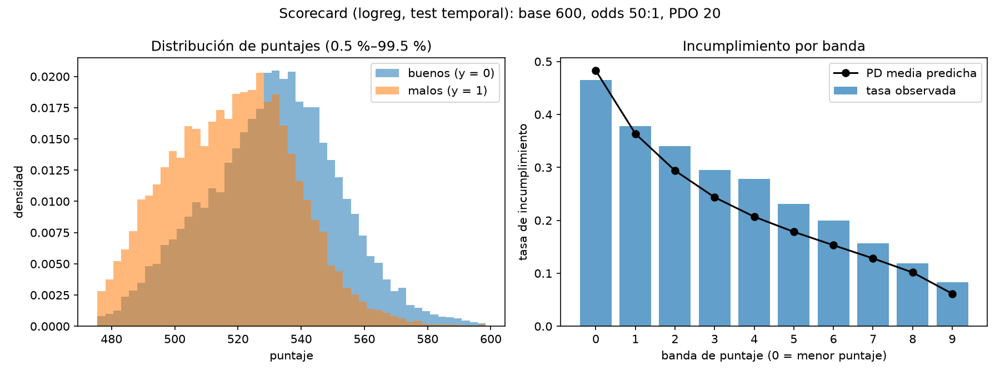

# Sección 3.7 (borrador): derivación de la scorecard

**Curso:** Redes Neuronales y Algoritmos Bioinspirados
**Universidad:** Universidad Nacional de Colombia
**Proyecto:** Trabajo 2 — Redes neuronales para datos tabulares (*¿me prestas?*)
**Responsable:** P4 · **Revisión:** P3 · **Estado:** borrador; la figura es provisional

> Implementación: `src/scorecard/scorecard.py` (transformación), `src/experiments/build_scorecard.py`
> (construcción) y `src/scorecard/api.py` (interfaz para la aplicación); pruebas en
> `tests/test_scorecard.py` y `tests/test_scorecard_api.py`. Parámetros en `configs/scorecard.yaml`,
> modificables con `--override base_score=... base_odds=... pdo=...`.

---

## 1. Convención

Siguiendo la guía del trabajo, se usan las odds de **buen** pagador: si $p$ es la PD,
$o = (1-p)/p$. Con el logit de la PD, $z = \ln\big(p/(1-p)\big)$, se cumple $\ln o = -z$. Un puntaje
más alto significa menos riesgo.

## 2. Derivación

El puntaje es lineal en el logaritmo de las odds: $S = A + B\ln o$. Se fijan tres parámetros: el
puntaje base $S_0$, las odds de referencia $O_0$ que le corresponden y los puntos para duplicar las odds
(PDO). Imponiendo

$$S_0 = A + B\ln O_0, \qquad S_0 + \text{PDO} = A + B\ln(2\,O_0),$$

y restando ambas ecuaciones se obtiene $\text{PDO} = B\ln 2$. Por tanto

$$B = \frac{\text{PDO}}{\ln 2}\ \ (\text{factor}), \qquad A = S_0 - B\ln O_0\ \ (\text{offset}), \qquad S = A - B\,z.$$

Con $S_0 = 600$, $O_0 = 50$ (es decir, PD $= 1/51 \approx 1{,}96\,\%$) y PDO $= 20$: $B = 28{,}8539$ y
$A = 487{,}1229$ (Tabla 3.7.1). Una persona con la tasa de incumplimiento media del entrenamiento
(PD $\approx 0{,}19$, odds $\approx 4{,}2$) obtiene unos 528 puntos.

| PD | Odds de buen pagador | Puntaje |
|---|---|---|
| $1/101 \approx 0{,}0099$ | 100 | 620,0 |
| $1/51 \approx 0{,}0196$ | 50 | 600,0 |
| 0,20 | 4 | 527,1 |
| 0,50 | 1 | 487,1 |

*Tabla 3.7.1. Puntaje para distintas PD con $S_0 = 600$, $O_0 = 50$ y PDO $= 20$. Fuente: elaboración
propia; valores verificados en `test_valores_conocidos`.*

La convención de odds importa: la primera versión de `configs/scorecard.yaml` tenía `base_odds: 0.05`,
que con odds de buen pagador corresponde a una PD de 0,95 en el puntaje base, una escala invertida.

## 3. Propiedades

1. **Monotonía.** $S$ es estrictamente decreciente en la PD: menor riesgo, más puntaje.
2. **Duplicar las odds suma PDO puntos**, por construcción.
3. **El puntaje base y el PDO solo cambian la escala.** Con otros parámetros $(S_0', \text{PDO}')$ y las
   mismas $O_0$, $S' = S_0' + (\text{PDO}'/\text{PDO})(S - S_0)$, una transformación afín creciente de $S$.
   Por eso el orden de los clientes, la AUC, el Gini, el KS, la calibración y el percentil no cambian; solo
   cambian los valores del puntaje. Por ejemplo, con $S_0' = 700$ y PDO$' = 40$, $S' = 2S - 500$, lo que se
   comprobó ejecutando `build_scorecard` con ambos juegos de parámetros. Lo único que cambia la PD es
   reentrenar o recalibrar el modelo.

## 4. Puntos por variable

**Regresión logística.** Con $z = \beta_0 + \sum_j \beta_j x_j$,

$$S = \underbrace{(A - B\beta_0)}_{\text{puntos base}} + \sum_j \underbrace{(-B\,\beta_j\,x_j)}_{\text{puntos de la variable } j},$$

de modo que cada variable aporta $-B\beta_j$ puntos por unidad; con variables estandarizadas, por cada
desviación estándar. La scorecard admite así variables continuas sin agruparlas en tramos. La
descomposición es exacta (error máximo de $6 \times 10^{-5}$ puntos en la prueba temporal). Dos
precauciones al leer los puntos: las variables casi colineales (`funded_amnt` y `funded_amnt_inv`)
reciben coeficientes de signo opuesto que se compensan, y las columnas casi constantes se comportan como
parte del intercepto, por lo que sus puntos individuales no son interpretables.

**Red neuronal.** Si $f(x)$ es la salida de la red antes de la sigmoide (el logit), $S = A - B f(x)$. Para
repartir el puntaje entre variables se usan valores SHAP calculados en el espacio del logit, que cumplen
$f(x) = \phi_0 + \sum_j \phi_j(x)$ (Lundberg y Lee, 2017); los puntos de la variable $j$ son
$-B\,\phi_j(x)$ y los puntos base, $A - B\phi_0$. *Pendiente: requiere el modelo final de la red (P2).*

## 5. Percentil

Para un puntaje $s$, el percentil es el porcentaje de la distribución de referencia (los puntajes del
conjunto de entrenamiento) que queda por debajo:
$\text{perc}(s) = 100 \cdot \#\{i : s_i^{\text{ref}} < s\} / N_{\text{ref}}$. La referencia se guarda en
`models/scorecard_referencia_<modelo>.npz` y la interfaz la convierte al espacio del logit, de modo que el
percentil de una persona no cambia si se modifican el puntaje base o el PDO (`test_percentil_no_depende_de_pdo_ni_base`).

## 6. Detalle numérico

El puntaje se calcula a partir del logit y no de la PD. Para logits muy negativos la PD es del orden de
$10^{-24}$, y una primera implementación que recortaba la PD a $10^{-12}$ antes de tomar logaritmos
desviaba el puntaje hasta 800 puntos. La versión actual calcula $\ln o = \ln(1-p) - \ln p$ con
`log1p` sin ese recorte y prioriza el logit; la prueba `test_logit_y_pd_coinciden_con_valores_extremos` cubre
logits entre $-50$ y $20$.

## 7. Ilustración (provisional)

**Figura 3.7.1.** Scorecard construida sobre la regresión logística: distribución de puntajes de buenos y
malos (izquierda) y tasa de incumplimiento observada frente a la PD media por decil de puntaje (derecha).
*Fuente:* elaboración propia con datos de Lending Club (Kaggle), prueba temporal (créditos originados en
2015); `python -m src.experiments.build_scorecard`.

Como se observa en la Figura 3.7.1, la tasa de incumplimiento decrece en todas las bandas de puntaje (de
46,5 % a 8,3 %), pero la PD media queda por debajo de la tasa observada en casi todas ellas, por el
cambio temporal entre entrenamiento y prueba. Esto motiva la recalibración. *La figura es provisional:
se rehará con el preprocesamiento corregido y con la red neuronal.*

---

### Referencias candidatas (verificar autores, año, editorial o revista, y DOI en la fuente primaria)

- Siddiqi, N. (2006). *Credit risk scorecards: Developing and implementing intelligent credit scoring*. Wiley.
- Lundberg, S. M., y Lee, S.-I. (2017). A unified approach to interpreting model predictions. En *Advances in Neural Information Processing Systems 30*.
- Thomas, L. C., Edelman, D. B., y Crook, J. N. (2002). *Credit scoring and its applications*. SIAM.
