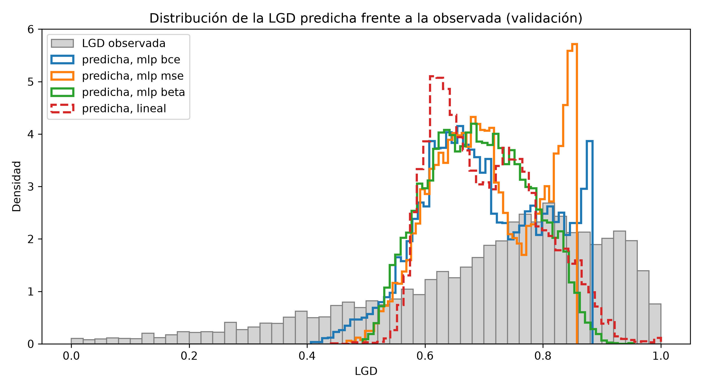
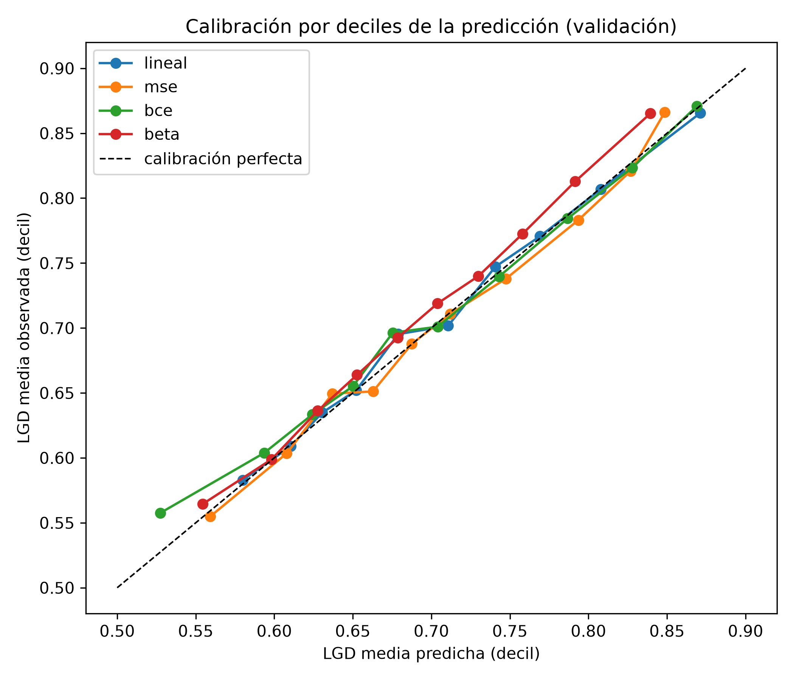
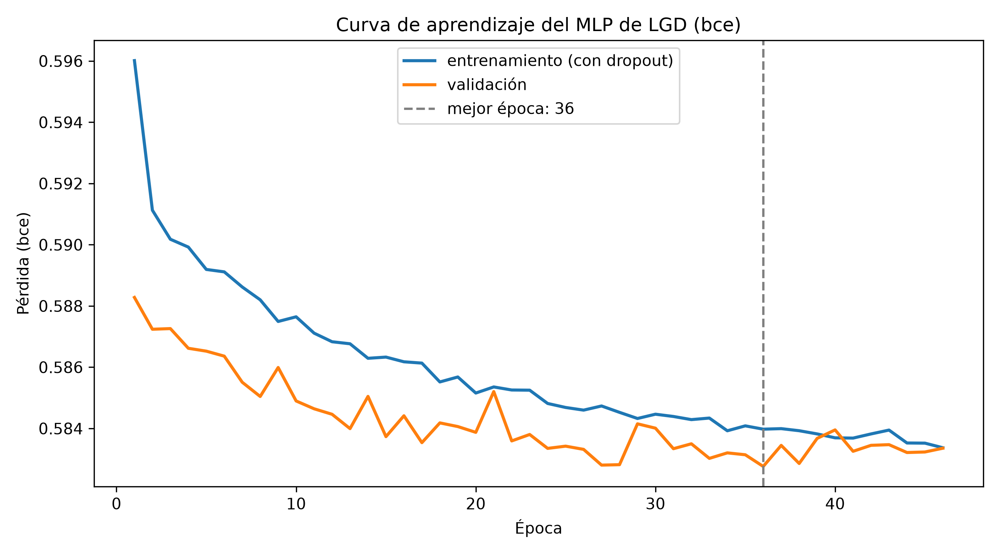

# 6.3 Red neuronal de LGD

**Curso:** Redes Neuronales y Algoritmos Bioinspirados  
**Universidad:** Universidad Nacional de Colombia  
**Proyecto:** Trabajo 2 — Redes neuronales para datos tabulares (*¿me prestas?*)  
**Estado:** borrador para integración

> Esta sección reporta la construcción y la selección del MLP de LGD. El criterio de selección y cuatro
> predicciones se fijaron antes de entrenar (sección 3.3, apartados 9 y 10); aquí se aplican y se
> contrastan. Todo se mide en la **validación de la partición aleatoria** ($n = 8.823$; entrenamiento
> $n = 41.173$, 82 variables, `split_seed: 90`). El conjunto de prueba no interviene: su evaluación
> está en la sección 6.4. La partición temporal se reporta solo como análisis de estabilidad
> (apartado 8). La numeración de figuras y tablas (6.3.x) y las remisiones a otras secciones, que siguen la estructura de la guía del curso, son provisionales hasta la integración del blog.

---

## 1. Búsqueda con presupuesto declarado

La búsqueda fue aleatoria y **pareada**: se muestrearon 12 configuraciones del espacio de la Tabla 6.3.1
(semilla 90) y cada una se entrenó con las tres pérdidas candidatas (MSE, BCE fraccional y Beta), en
total **36 entrenamientos y 24,4 minutos**. Todas usan Adam (sección 3.5), hasta 100 épocas, parada
temprana con paciencia 10 sobre la pérdida de validación, lotes de 256 y salida sigmoide (sección 3.3,
apartado 7). Al parear, las tres pérdidas reciben exactamente las mismas arquitecturas y el mismo
presupuesto, así que la comparación entre ellas no depende de cuál tuvo más suerte en el muestreo.

| Hiperparámetro | Valores posibles |
|---|---|
| Capas ocultas | [32], [64], [64, 32], [128, 64], [128, 64, 32] |
| Activación oculta | ReLU, tanh |
| Dropout | 0; 0,1; 0,2; 0,3 |
| Tasa de aprendizaje | $3\times10^{-4}$, $10^{-3}$, $3\times10^{-3}$ |
| Penalización L2 | 0, $10^{-5}$, $10^{-4}$, $10^{-3}$ |
| Pérdida | MSE, BCE fraccional, Beta |

**Tabla 6.3.1.** Espacio de búsqueda del MLP de LGD. *Fuente:* elaboración propia; `ESPACIO` y
`PERDIDAS` en `src/search/lgd_random_search.py`.

La Tabla 6.3.2 muestra la mejor configuración de cada pérdida y la mejor con ReLU.

| Config. | Pérdida | Capas | Activación | Dropout | lr | L2 | RMSE | $R^2$ | sd predicha | Épocas |
|---|---|---|---|---|---|---|---|---|---|---|
| 9 | BCE | [128, 64, 32] | tanh | 0,1 | 0,003 | $10^{-5}$ | 0,17735 | 0,230 | 0,1014 | 40 |
| 9 | MSE | [128, 64, 32] | tanh | 0,1 | 0,003 | $10^{-5}$ | 0,17735 | 0,230 | 0,0948 | 53 |
| 9 | Beta | [128, 64, 32] | tanh | 0,1 | 0,003 | $10^{-5}$ | 0,17991 | 0,208 | 0,0876 | 34 |
| 5 | MSE | [128, 64] | ReLU | 0 | 0,001 | $10^{-4}$ | 0,17756 | 0,228 | 0,1024 | 34 |

**Tabla 6.3.2.** Mejor configuración por pérdida en la búsqueda (una semilla, validación aleatoria).
*Fuente:* elaboración propia; `results/tables/lgd_busqueda.csv`.

- **Las tres pérdidas eligen la misma configuración (la 9).** La diferencia que queda entre ellas se
  debe a la pérdida y no a la arquitectura.
- **La tanh gana en la mejor configuración, pero no en general.** La mediana del RMSE es 0,17925 con ReLU
  y 0,18000 con tanh (18 entrenamientos cada una). No se puede afirmar que la tanh sea mejor activación
  para este problema; solo que la mejor configuración la usa. El apartado 7 vuelve sobre esto.
- **MSE y BCE quedan empatadas** en la búsqueda: el RMSE coincide hasta la quinta cifra decimal.

## 2. Treinta semillas

La configuración 9 se reentrenó con las semillas 0 a 29 para cada pérdida (Tabla 6.3.3). La regresión
lineal de referencia es determinista y se entrena una sola vez.

| Modelo | RMSE (media ± sd) | Mejor | Peor | MAE | $R^2$ | sd predicha | Parámetros | Minutos (30 semillas) |
|---|---|---|---|---|---|---|---|---|
| MLP BCE | 0,17728 ± 0,00019 | 0,17695 | 0,17765 | 0,1370 | 0,231 | 0,0973 | 20.993 | 31,9 |
| MLP MSE | 0,17741 ± 0,00022 | 0,17696 | 0,17784 | 0,1373 | 0,230 | 0,0960 | 20.993 | 26,4 |
| MLP Beta | 0,17992 ± 0,00039 | 0,17930 | 0,18086 | 0,1404 | 0,208 | 0,0869 | 20.994 | 17,9 |
| Lineal | 0,18166 | — | — | 0,1404 | 0,192 | 0,0877 | 83 | < 0,1 |

**Tabla 6.3.3.** Configuración 9 con 30 semillas en la validación aleatoria. La sd predicha es la
desviación estándar de las predicciones (la observada es 0,202). *Fuente:* elaboración propia;
`results/tables/lgd_semillas_resumen.csv` y `lgd_semillas_{bce,mse,beta}.csv`.

- **La red mejora a la lineal en todas las semillas.** La peor semilla de la BCE (0,17765) está por debajo
  de la lineal (0,18166). La mejora es pequeña: **2,4 % de RMSE** y de 0,192 a 0,231 de $R^2$, a cambio
  de 253 veces más parámetros y unos 64 segundos de entrenamiento por semilla.
- **La variabilidad entre semillas es pequeña** frente a las diferencias entre pérdidas, salvo entre BCE
  y MSE (apartado 3).
- **Presupuesto total de la familia.** La búsqueda (36 entrenamientos, 24,4 min) y las 30 semillas de
  cada pérdida (90 entrenamientos, 76,2 min) suman 126 entrenamientos y 100,6 minutos, sin contar los
  diagnósticos (5 con ReLU, 4 de $\varepsilon$ y 5 temporales). La lineal se ajustó una sola vez, en menos
  de 0,1 minutos: la ventaja de la red se obtuvo con 36 configuraciones frente a 1.

## 3. Empate y desempate

El criterio prerregistrado (sección 3.3, apartado 9) elige por RMSE en validación y, si hay empate,
desempata con la distribución de las predicciones. Una primera versión del trabajo eligió la MSE por el
RMSE de la búsqueda sin aplicar ese desempate; aquí se corrige.

- **Empate.** La diferencia media de RMSE entre BCE y MSE en las 30 semillas es $1{,}2\times10^{-4}$,
  por debajo de la tolerancia de $2{,}5\times10^{-4}$ (la desviación entre semillas; la tolerancia se
  fijó después de la primera corrida, como se aclara en la sección 3.3).
- **Desempate.** Todas las redes encogen las predicciones (apartado 5), así que se prefiere la de mayor
  dispersión: en la búsqueda, 0,1014 (BCE) frente a 0,0948 (MSE); en las 30 semillas, 0,0973 frente a
  0,0960. **Gana la BCE fraccional.** El KS y la distancia de Wasserstein (Tabla 6.3.5) apuntan en la misma
  dirección.
- **Comprobación no prerregistrada.** Comparando por semilla, la BCE tiene menor RMSE en 19 de 30 semillas;
  una prueba $t$ pareada da $t = -2{,}28$, $p = 0{,}03$ (Wilcoxon: $p = 0{,}023$). La diferencia parece
  sistemática, pero es del 0,07 % del RMSE, sin importancia práctica. Como el RMSE y el desempate eligen
  la misma pérdida, **la decisión no depende de cómo se fijó la tolerancia**.

## 4. Contraste de las predicciones prerregistradas

La Tabla 6.3.4 contrasta cada predicción escrita antes de entrenar con el resultado.

| # | Predicción (sección 3.3, apartado 10) | Resultado | Veredicto |
|---|---|---|---|
| 1 | RMSE parecido entre las tres pérdidas | Entre 0,1773 y 0,1799: 1,5 % de diferencia máxima | Se cumple |
| 2 | Las tres encogen las predicciones (sd muy por debajo de 0,20) | sd predicha entre 0,087 y 0,097 frente a 0,202 observada | Se cumple |
| 3 | La MSE no supera a la BCE; la diferencia se vería en LGD alta | La MSE no la supera (apartado 3), pero en el 20 % de LGD más alta el RMSE es igual: 0,1955 (BCE) y 0,1953 (MSE) | Se cumple el resultado; el mecanismo propuesto no se observa |
| 4 | La Beta describe mejor la forma de la distribución | La Beta tiene el peor KS, el peor Wasserstein y la menor dispersión (Tabla 6.3.5) | **Refutada** |

**Tabla 6.3.4.** Contraste de las predicciones escritas antes de entrenar. *Fuente:* elaboración propia;
predicciones de 30 semillas en `results/tables/lgd_pred_val_{bce,mse,beta}.csv.gz`.

La predicción 4 falló por una razón que vale la pena explicar. La Beta ajusta mejor la **distribución
marginal** de la LGD (sección 3.3, Figura 3.3.1), pero lo que se compara aquí es la distribución de las
**predicciones puntuales** (la media $\mu$ de cada crédito), no la de la distribución predictiva completa.
Una pérdida que describe bien la forma de $y$ no garantiza que sus medias se dispersen como $y$. Además,
la Beta subestima la LGD en los deciles altos (apartado 6), lo que la encoge todavía más.

## 5. Distribución predicha frente a la observada

El enunciado pide comparar la distribución de las predicciones con la observada. La Tabla 6.3.5 resume la
comparación promediada sobre las 30 semillas, la Tabla 6.3.6 da los cuantiles y la Figura 6.3.1 muestra
los histogramas de una semilla.

| Modelo | KS (media ± sd) | Wasserstein (media ± sd) | sd predicha / sd observada | Mín. predicho | Máx. predicho | Observadas bajo el mín. | Observadas sobre el máx. |
|---|---|---|---|---|---|---|---|
| MLP BCE | 0,213 ± 0,009 | 0,0858 ± 0,0033 | 0,48 | 0,42 | 0,875 | 10,8 % | 21,2 % |
| MLP MSE | 0,223 ± 0,009 | 0,0863 ± 0,0024 | 0,47 | 0,45 | 0,871 | 12,8 % | 22,1 % |
| MLP Beta | 0,288 ± 0,016 | 0,0961 ± 0,0034 | 0,43 | 0,38 | 0,841 | 8,7 % | 28,7 % |
| Lineal | 0,225 | 0,0952 | 0,43 | 0,46 | 1,000 | 13,1 % | 0,0 % |

**Tabla 6.3.5.** Distribución de las predicciones frente a la LGD observada en validación (media de 30
semillas; la lineal es determinista). *Fuente:* elaboración propia; `comparar_distribuciones` de
`src/evaluation/distributions.py` aplicada a `results/tables/lgd_pred_val_{bce,mse,beta}.csv.gz` con
`python -m src.search.lgd_random_search --fase distribucion`, `results/tables/lgd_distribucion_val.csv`.

| Cuantil | Observada | MLP BCE | MLP MSE | MLP Beta | Lineal |
|---|---|---|---|---|---|
| 1 % | 0,112 | 0,499 | 0,506 | 0,496 | 0,560 |
| 10 % | 0,411 | 0,585 | 0,586 | 0,581 | 0,601 |
| 25 % | 0,598 | 0,631 | 0,632 | 0,629 | 0,631 |
| 50 % | 0,751 | 0,697 | 0,697 | 0,694 | 0,697 |
| 75 % | 0,858 | 0,787 | 0,789 | 0,763 | 0,769 |
| 90 % | 0,931 | 0,848 | 0,845 | 0,816 | 0,834 |
| 99 % | 0,987 | 0,873 | 0,867 | 0,838 | 0,903 |

**Tabla 6.3.6.** Cuantiles de la LGD observada y predicha en validación (para las redes, promedio de los
cuantiles de las 30 semillas). *Fuente:* elaboración propia; mismo comando que la Tabla 6.3.5,
`results/tables/lgd_cuantiles_val.csv`.

**Figura 6.3.1.** Histograma de la LGD observada en validación (gris) y de las predicciones de la semilla
0 de cada red y de la lineal. *Fuente:* elaboración propia; `fase_resumir` en
`src/search/lgd_random_search.py`, `results/figures/lgd_pred_vs_obs.png`.

- **Todas encogen.** La sd predicha es menos de la mitad de la observada. El percentil 1 observado es
  0,11, pero ninguna red predice por debajo de 0,38. Era lo esperado (predicción 2): una red que estima
  la media condicional con un $R^2$ de 0,23 no puede reproducir la dispersión de $y$, porque la mayor
  parte de esa dispersión no la explican las variables.
- **La BCE es la más cercana a la observada** en KS y Wasserstein, aunque frente a la MSE la diferencia en
  Wasserstein es menor que su desviación entre semillas. En KS la BCE es menor en 25 de 30 semillas.
- **Las redes no llegan a la cola alta.** Entre el 21 % y el 29 % de las LGD observadas superan la mayor
  predicción. En la Figura 6.3.1 las redes acumulan masa justo en su máximo (un pico estrecho cerca de
  0,87 para BCE y MSE, y de 0,84 para la Beta). La lineal, que no tiene sigmoide, sí llega a 1 (en
  realidad se recorta en 1). El apartado 7 estudia si ese tope le cuesta algo a la red.

## 6. Calibración por deciles

**Figura 6.3.2.** LGD media observada frente a la predicha en cada decil de la predicción (semilla 0,
validación). Los colores no coinciden con los de la Figura 6.3.1: aquí la BCE es verde y la lineal azul.
*Fuente:* elaboración propia; `fase_diagnostico` en `src/search/lgd_random_search.py`,
`results/tables/lgd_calibracion_deciles.csv`.

Como se observa en la Figura 6.3.2, la BCE, la MSE y la lineal están cerca de la diagonal en todos los
deciles (la mayor distancia es de 0,014, de la MSE en el decil 4). La BCE sobrestima un poco entre los deciles 7 y 9 (por ejemplo, 0,834 predicha frente a 0,824
observada en el decil 9). La **Beta subestima la LGD en los deciles altos**: 0,823 frente a 0,868 en el
decil 10, y su media predicha (0,694 en promedio de las 30 semillas; 0,686 en la semilla 0 de la figura) queda 0,012 por debajo de la observada (0,706).

*Hipótesis, no comprobada:* con valores de $y$ recortados a $1-\varepsilon$, el término $\log(1-y)$ de
la Beta es muy grande y desplaza la media estimada hacia abajo. Es coherente con la sensibilidad a
$\varepsilon$ (sección 3.3, apartado 11): el RMSE de la Beta mejora de 0,1799 con
$\varepsilon = 10^{-4}$ a 0,1788 con $\varepsilon = 10^{-2}$ (`results/tables/lgd_sensibilidad_eps.csv`).

## 7. El techo de la tanh

La última capa oculta usa tanh, así que cada una de sus 32 neuronas vale entre −1 y 1. El logit de salida
$z = b + \sum_j w_j h_j$ queda acotado por $b + \sum_j |w_j|$, y la red **no puede predecir más que**

$$\text{techo} = \sigma\Big(b + \sum_j |w_j|\Big).$$

La Tabla 6.3.7 compara ese techo con las predicciones de las 30 semillas y con la misma red con ReLU.

| Diagnóstico (30 semillas) | Media | Mín. | Máx. |
|---|---|---|---|
| Techo teórico $\sigma(b + \sum_j \lvert w_j\rvert)$ | 0,877 | 0,867 | 0,887 |
| Predicción máxima en validación | 0,875 | 0,865 | 0,884 |
| Neuronas saturadas ($\lvert h\rvert > 0{,}99$), 1 % de predicciones más altas | 44 % | 18 % | 72 % |
| Neuronas saturadas, resto de predicciones | 19 % | 10 % | 26 % |
| RMSE con tanh (semillas 0–4) | 0,17734 | | |
| RMSE con ReLU, misma configuración (semillas 0–4) | 0,17888 | | |

**Tabla 6.3.7.** Diagnóstico del techo de la tanh en la red BCE (validación aleatoria). *Fuente:*
elaboración propia; `fase_diagnostico` en `src/search/lgd_random_search.py`,
`results/tables/lgd_diagnostico_techo.csv` y `lgd_techo_relu.csv`.

- **La red llega al techo.** La predicción máxima es el 99,8 % del techo teórico, y en las predicciones
  más altas el doble de neuronas están saturadas. Eso explica el pico en el máximo de la Figura 6.3.1.
- **Pero el techo no cuesta RMSE.** El decil más alto está calibrado (0,864 predicha, 0,868 observada;
  Figura 6.3.2), y la misma configuración con ReLU, que no tiene techo, es **peor en las 5 semillas**
  (0,17888 frente a 0,17734).
- **Conclusión:** el 21 % de observadas por encima del máximo se debe sobre todo al encogimiento (la red
  predice medias), no al techo. Esto tiene límites: la ReLU se probó con hiperparámetros elegidos para la
  tanh y con solo 5 semillas.

## 8. Estabilidad temporal

Se reentrenó la configuración final con la partición temporal: entrenamiento hasta 2013 ($n = 31.527$),
validación 2014 ($n = 19.441$). La prueba (2015) no se usó. La Tabla 6.3.8 compara la red (5 semillas)
con la lineal.

| Modelo | RMSE | MAE | $R^2$ | LGD media predicha | Sesgo |
|---|---|---|---|---|---|
| MLP BCE (5 semillas: media) | 0,164 | 0,138 | −0,81 | 0,646 | −0,122 |
| MLP BCE (rango) | 0,155 – 0,169 | 0,128 – 0,144 | −0,93 – −0,61 | 0,637 – 0,658 | −0,131 – −0,110 |
| Lineal | 0,174 | 0,148 | −1,04 | 0,632 | −0,136 |

**Tabla 6.3.8.** Configuración final con partición temporal, validación 2014. LGD media observada: 0,615
en entrenamiento y 0,768 en validación. *Fuente:* elaboración propia; `fase_temporal` en
`src/search/lgd_random_search.py`, `results/tables/lgd_estabilidad_temporal.csv`.

- **El $R^2$ es negativo aunque el RMSE es menor que en la partición aleatoria.** En 2014 la LGD es más
  alta (0,768 frente a 0,615) y menos dispersa (sd 0,122 frente a 0,216). Los modelos aprenden la media
  de entrenamiento y quedan unas 0,12 por debajo; con tan poca varianza en validación, ese sesgo basta
  para que el $R^2$ sea negativo.
- **La causa es la censura de las recuperaciones** (sección 3.1): los créditos recientes han tenido menos
  tiempo para recuperar, así que su LGD observada es más alta. No es un fallo de la red, y por eso la
  selección se hizo con la partición aleatoria (sección 3.3, apartado 9).
- **Aun así, la red tiene menos sesgo y menor RMSE que la lineal** en las 5 semillas.

## 9. Curva de entrenamiento

**Figura 6.3.3.** Pérdida BCE de entrenamiento y validación por época, configuración final, semilla 0.
*Fuente:* elaboración propia; `fase_resumir` en `src/search/lgd_random_search.py`,
`results/figures/lgd_curva_aprendizaje.png`.

Como se observa en la Figura 6.3.3, la pérdida de validación alcanza su mínimo en la época 29, y la parada temprana detiene el entrenamiento
10 épocas después. La curva de entrenamiento queda **por encima** de la de validación por dos razones, y
ninguna indica un problema: se mide con dropout activo y la de validación sin él, e incluye la
penalización L2, que la de validación no tiene. Con los pesos finales de la semilla 0 ese término vale
0,0018, del mismo orden que la brecha entre las curvas en la mejor época (unas 0,003; sección 3.5,
apartado 8). El rango de la pérdida es estrecho (de
0,582 a 0,596) porque la BCE fraccional tiene un piso igual a la entropía de $y$ (sección 3.3, apartado
8): su valor absoluto no es comparable con el de otras pérdidas, y por eso la selección usa el RMSE.

## 10. Limitaciones y ajustes

- **No se ajustó la red para reproducir la distribución observada.** La guía sugiere hacerlo si la
  distribución predicha no reproduce la observada. Se probaron tres posibles causas: la activación (ReLU
  en vez de tanh, apartado 7), la pérdida (la Beta, apartado 5) y $\varepsilon$ en la Beta (apartado 6).
  Ninguna acercó las distribuciones sin empeorar el RMSE. *Hipótesis:* cualquier ajuste que ensanche
  las predicciones puntuales las alejaría de la media condicional y subiría el RMSE. Si la aplicación
  necesitara la distribución completa de la LGD de un crédito, lo indicado sería usar la distribución
  predictiva (por ejemplo, la Beta con $\mu$ y $\phi$), no las predicciones puntuales.
- **La precisión $\phi$ de la Beta es constante.** La sección 3.3 (apartado 11) dejó como ajuste posible
  modelarla en función de las variables; no se hizo.
- **El desempate se probó con la desviación estándar de las predicciones**, que resume la forma en un
  solo número. El KS y el Wasserstein de la Tabla 6.3.5 lo confirman, pero se calcularon después de
  elegir.
- **La comparación con ReLU** usa 5 semillas e hiperparámetros elegidos para la tanh.
- **Todo está medido en validación**, que también se usó para seleccionar. La estimación sin sesgo de
  selección es la de prueba (sección 6.4).
