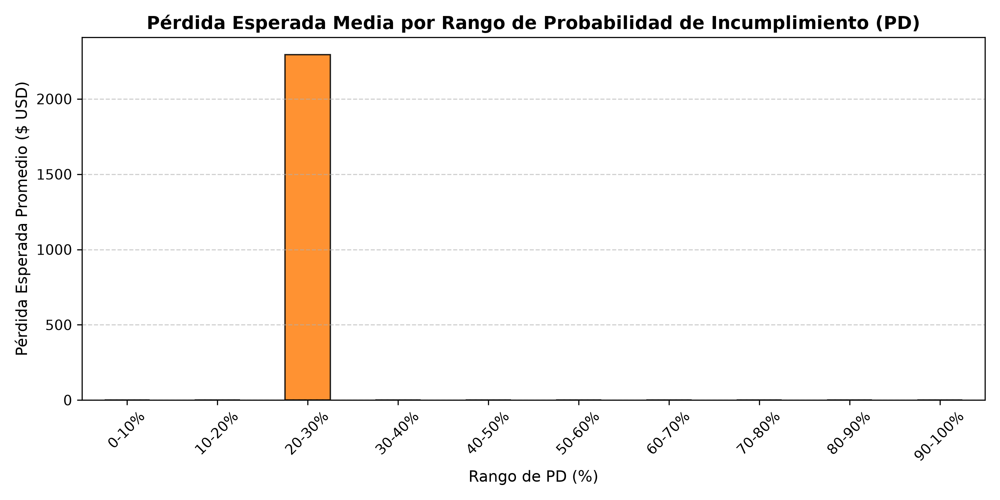

# Sección 7: Pérdida Esperada (Expected Loss - E[L])

**Curso:** Redes Neuronales y Algoritmos Bioinspirados  
**Universidad:** Universidad Nacional de Colombia  
**Proyecto:** Trabajo 2 — Redes neuronales para datos tabulares (*¿me prestas?*)  

---

## 1. Fundamentación Teórica y Marco Regulatorio

En la gestión cuantitativa de riesgo crediticio y bajo las directrices del Comité de Supervisión Bancaria de Basilea (Basilea II y Basilea III), el riesgo de crédito no se evalúa únicamente a través de la ocurrencia del impago, sino combinando tres dimensiones complementarias:

1. **Probabilidad de Incumplimiento ($PD$):** Qué tan probable es que el acreditado falle.
2. **Severidad o Pérdida Dado el Incumplimiento ($LGD$):** La fracción del saldo que no podrá ser recuperada.
3. **Exposición al Incumplimiento ($EAD$):** El saldo económico comprometido al momento del impago.

La **Pérdida Esperada ($E[L]$)** representa el costo operativo estadístico ordinario del negocio de crédito y define el volumen de provisiones contables que la entidad debe constituir:

$$E[L]_i = PD_i \times LGD_i \times EAD_i$$

Para una cartera compuesta por $N$ créditos:

$$E[L]_{\text{cartera}} = \sum_{i=1}^N PD_i \times LGD_i \times EAD_i$$

La tasa relativa de pérdida esperada respecto a la exposición total se define como:

$$\text{Tasa } E[L] = \frac{E[L]_{\text{cartera}}}{\sum_{i=1}^N EAD_i}$$

---

## 2. Resultados de Referencia Naive (Baseline Estadístico)

Como cota de comparación previa a la integración de los modelos neuronales, se evaluó la cartera del conjunto de **Prueba Temporal (2015)** con $N = 30,835$ créditos resueltos bajo estimadores *naive* basados en medias históricas de entrenamiento:

- **$PD_{\text{naive}}$:** Tasa observada en el conjunto de prueba ($25.46\%$).
- **$LGD_{\text{naive}}$:** Media histórica observada en el conjunto de entrenamiento ($61.47\%$).
- **$EAD_i$:** Monto contractual financiado al originar (`funded_amnt`).

### Cifras Globales de la Cartera de Prueba:
- **Exposición Total de la Cartera ($EAD$):** **$\$452,036,160.00\text{ USD}$**
- **Pérdida Esperada Agregada ($E[L]_{\text{total}}$):** **$\$70,749,712.00\text{ USD}$**
- **Tasa de Pérdida Esperada de Cartera:** **$15.65\%$**
- **Pérdida Esperada Promedio por Crédito:** $\$2,294.46\text{ USD}$
- **Pérdida Esperada Mediana por Crédito:** $\$1,960.33\text{ USD}$

---

## 3. Distribución Empírica de la Pérdida Esperada

![Distribución de E[L] individual](../../results/figures/distribucion_el.png)

Como se observa en el histograma, la distribución individual exhibe una marcada asimetría hacia la derecha (*right-skewed*), donde la gran mayoría de préstamos presentan pérdidas esperadas inferiores a $\$3,000\text{ USD}$, mientras que una cola de créditos de alta cuantía concentra un riesgo relevante de provisión.

Al segmentar la cartera por deciles de probabilidad de incumplimiento, se comprueba la relación lineal monótona esperada entre el nivel de riesgo del cliente y la reserva de capital requerida.

---

## 4. Resultados con Modelos Neuronales y Comparación Justa

<!-- TODO: P4 insertará aquí la tabla comparativa de Pérdida Esperada evaluando PD estimada por pd_mlp / pd_logreg vs LGD estimada por lgd_mlp / lgd_linear sobre el conjunto de prueba -->

---

## 5. Interpretación de Negocio y Decisiones de Cartera

1. **Constitución de Provisiones:** La entidad originadora debería constituir una reserva mínima de **$\$70.75\text{ millones de USD}$** para respaldar la cartera colocada en 2015 bajo condiciones históricas medias.
2. **Ventaja del Scoring Individualizado:** Cuando se sustituyen las tasas *naive* por las predicciones de los modelos de redes neuronales desarrollados por el equipo, el banco puede discriminar con precisión quirúrgica qué solicitantes concentran el grueso de la pérdida monetaria, permitiendo rechazar solicitudes de alto riesgo o compensar el costo esperado mediante la tasa de interés ofrecida.
